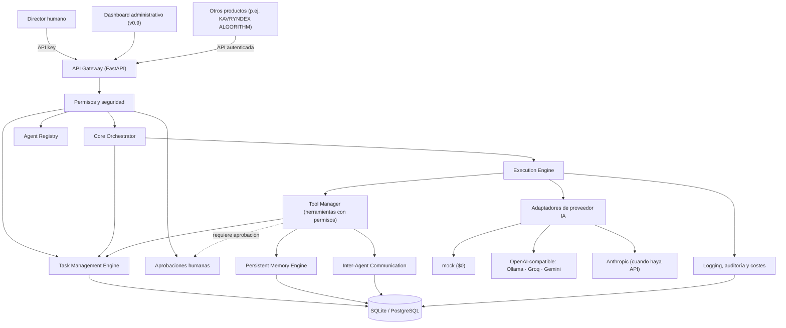
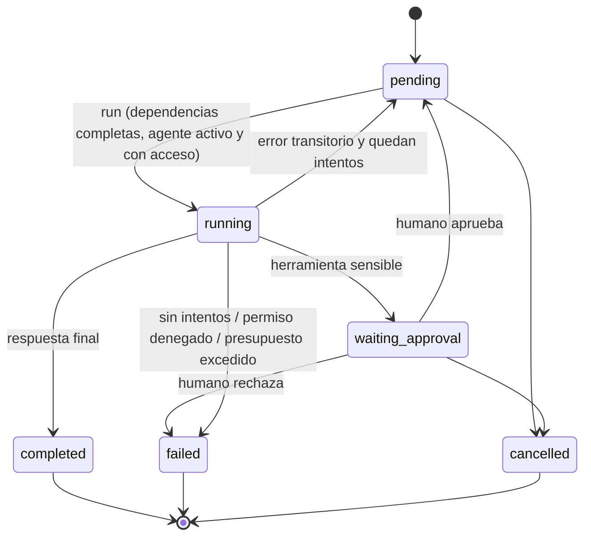
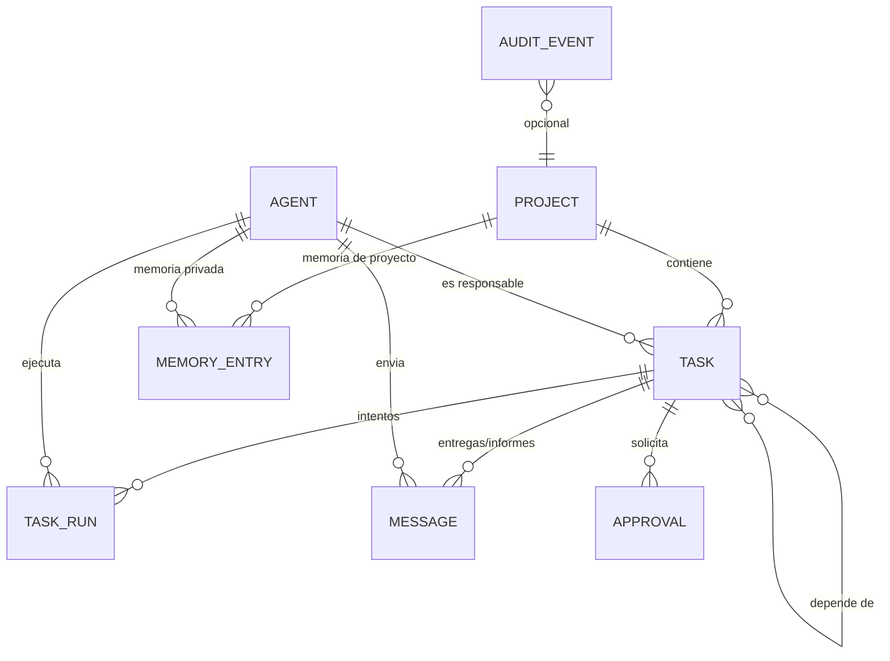

# KAVRYNDEX AI OFFICE — Project Foundation

> Documento de fundación técnica · Versión 1.0 · 2026-11-04
> Estado: **propuesta para aprobación** del director del proyecto (Phillip).
> Convención de evidencia: **VERIFICADO** (inspeccionado directamente), **INFERIDO** (deducido de evidencia), **DESCONOCIDO** (requiere información adicional).

---

## 0. Resumen ejecutivo

KAVRYNDEX AI OFFICE es una plataforma **independiente, modular y API-first** que opera una oficina de agentes de IA especializados. Los agentes **no conversan libremente entre sí**: colaboran mediante **tareas estructuradas, dependencias, entregas (handoffs) y memoria compartida con permisos**, todo persistido y auditado.

Decisiones clave:

| Decisión | Elección | Motivo |
|---|---|---|
| Backend | Python 3.12+ · FastAPI · SQLAlchemy 2 | Ecosistema IA maduro, tipado, API documentada automáticamente (OpenAPI). |
| Persistencia | SQLite (local/tests) → PostgreSQL (cloud) | Mismo ORM y modelo; cero coste en desarrollo. |
| IA | Capa de **adaptadores de proveedor** | Sin dependencia de un proveedor ni de una suscripción personal. |
| Proveedor por defecto | `mock` determinista ($0) | Permite desarrollar y probar todo el sistema sin gastar. |
| Proveedores reales | Adaptador OpenAI-compatible (Ollama local, Groq, Gemini…) y, más adelante, Anthropic | Se activan por configuración; los de pago están **bloqueados por defecto**. |
| Ejecución | **Bajo demanda** (por API) | La infraestructura gratuita no garantiza ejecución 24/7. |
| Seguridad | API key de administrador, permisos por agente/proyecto/herramienta, aprobaciones humanas, auditoría | Autonomía alta pero controlada; sin ejecución arbitraria de comandos. |
| Coste inicial | **USD $0** | GitHub Free + open source + niveles gratuitos verificables. |

---

## 1. Estado actual del repositorio

| Hallazgo | Estado |
|---|---|
| Repositorio `phillip209/kavryndex-ai-office` existe, privado, con acceso de escritura para esta sesión. | VERIFICADO |
| El repositorio está **vacío**: sin commits, sin rama `main`, sin archivos. | VERIFICADO (`git clone` → "You appear to have cloned an empty repository") |
| No existe trabajo previo que preservar ni conflictos posibles. | VERIFICADO |
| Ninguno de los otros 22 repositorios de `phillip209` contiene código de KAVRYNDEX, agentes o IA (son proyectos de curso con Express/MongoDB/React y el repo `pre-workout-videos`). | VERIFICADO (auditoría previa por nombre y contenido) |
| Código reutilizable de otros repos: ninguno directo. Patrón JWT + bcrypt de `Proyecto_sena_backend` sirve solo como referencia conceptual. | VERIFICADO |
| Entorno local del director (SO, herramientas, proyectos, bases de datos). | **DESCONOCIDO** — pendiente del informe de `kavryndex_audit.ps1`. |
| Código de KAVRYNDEX ALGORITHM. | **DESCONOCIDO** — fuera de alcance por decisión; solo se integrará vía API. |

**Impacto de lo desconocido:** ninguna decisión de esta fase depende del entorno local, porque el objetivo es cloud y el sistema se ejecuta en Python estándar. El informe local sí será necesario antes de: (a) usar modelos locales con Ollama, (b) empaquetar el escritorio con Tauri (v0.9).

---

## 2. Principios de arquitectura

1. **Independencia:** AI OFFICE no comparte base de datos ni código con otros productos. La integración con KAVRYNDEX ALGORITHM u otros proyectos será **exclusivamente por APIs autenticadas, documentadas y versionadas**.
2. **Colaboración estructurada, no chat:** la unidad de trabajo es la **tarea** (con responsable, dependencias, presupuesto, resultado). Los mensajes son entregas e informes ligados a tareas.
3. **Proveedor-agnóstico:** el núcleo nunca importa SDKs de IA. Solo conoce la interfaz `LLMProvider`.
4. **Mínimo privilegio:** cada agente tiene herramientas, proyectos y memoria explícitamente autorizados.
5. **Humano al mando:** acciones destructivas, gasto y operaciones externas requieren aprobación humana.
6. **Todo queda registrado:** cada operación relevante genera un evento de auditoría.
7. **Coste cero por defecto:** los proveedores de pago no pueden ejecutarse sin un cambio explícito de configuración.

---

## 3. Arquitectura propuesta



### 3.1 Componentes

| Componente | Responsabilidad | Módulo (`src/kavryndex_office/`) | Versión |
|---|---|---|---|
| **API Gateway** | Endpoints REST, validación, OpenAPI, autenticación. | `api.py`, `*/router.py` | MVP |
| **Permissions & Security Layer** | API key, acceso por proyecto, herramientas autorizadas, presupuestos. | `security.py`, `tools/`, `execution/` | MVP |
| **Agent Registry** | Alta, configuración, rol, instrucciones, permisos y ciclo de vida de agentes. | `agents/` | MVP |
| **Task Management Engine** | Tareas, asignación, dependencias, prioridades, reintentos, estados. | `tasks/` | MVP |
| **Execution Engine** | Ejecuta una tarea con su agente: contexto, bucle de razonamiento, herramientas, límites, resultados. | `execution/engine.py` | MVP |
| **Core Orchestrator** | Ejecuta en orden las tareas listas de un proyecto; el agente CEO delega subtareas con la herramienta `task_delegate`. | `execution/orchestrator.py` | MVP (básico) → v0.4 (planificación) |
| **Persistent Memory Engine** | Memoria con alcance `agent` / `project` / `organization`. | `memory/` | MVP (texto) → v0.6 (búsqueda semántica) |
| **Inter-Agent Communication** | Entregas, informes y solicitudes ligadas a tareas. | `communication/` | MVP |
| **Tool Manager** | Registro de herramientas con esquema, permisos y bandera de aprobación. | `tools/` | MVP (internas) → v0.7 (externas) |
| **Logging & Monitoring** | Auditoría, tokens y coste por ejecución. | `audit/`, `TaskRun` | MVP → v0.8 (métricas) |
| **Administrative Dashboard** | Interfaz web/escritorio. | `apps/dashboard/` (futuro) | v0.9 |

### 3.2 Ciclo de vida de una tarea



### 3.3 Bucle de ejecución (Execution Engine)

1. Valida: tarea `pending`, dependencias `completed`, agente asignado, activo y con acceso al proyecto, proveedor permitido por la política de coste.
2. Crea un `TaskRun` (intento) y construye el contexto: instrucciones del agente + reglas de la oficina + tarea + **resultados de las dependencias (handoff)** + memoria legible por el agente.
3. Llama al proveedor con la lista de herramientas **autorizadas para ese agente**.
4. Si el modelo pide herramientas: verifica permiso → si es sensible y no está aprobada, crea una `Approval` y pausa la tarea → si no, la ejecuta y devuelve el resultado al modelo.
5. Repite hasta respuesta final o hasta `max_steps`; controla `max_tokens_per_task`.
6. Guarda resultado, tokens y coste, publica un informe de entrega y registra auditoría.

---

## 4. Stack tecnológico recomendado

| Capa | Tecnología | Justificación | Coste |
|---|---|---|---|
| Lenguaje | Python 3.12+ | Estándar en IA; tipado moderno. | $0 |
| API | FastAPI + Uvicorn | Rápido, validación con Pydantic, OpenAPI/Swagger automático (base del API-first). | $0 |
| ORM | SQLAlchemy 2.x | Portable SQLite ↔ PostgreSQL; tipado. | $0 |
| Configuración | pydantic-settings + variables de entorno | Secretos fuera del código (`SecretStr`). | $0 |
| BD local/tests | SQLite | Sin instalación ni servidor. | $0 |
| BD cloud | PostgreSQL gestionado (Neon Free recomendado) | Postgres estándar, plan gratuito permanente sin tarjeta. | $0 |
| Migraciones | Alembic (v0.2) | Evolución segura del esquema en PostgreSQL. | $0 |
| Pruebas | pytest + pytest-cov + httpx | Pruebas unitarias y de API sin red. | $0 |
| Calidad | Ruff (lint + formato) + mypy | Un solo linter rápido; verificación de tipos. | $0 |
| CI | GitHub Actions | Incluido en GitHub Free (cuota mensual para repos privados). | $0 dentro de cuota |
| IA (desarrollo) | Proveedor `mock` | Determinista; pruebas reproducibles. | $0 |
| IA (real, gratis) | Ollama local · Groq Free · Gemini API Free vía adaptador OpenAI-compatible | Niveles gratuitos sin tarjeta; límites por minuto/día. | $0 dentro de cuota |
| IA (futuro) | Anthropic API (Claude) | Proveedor principal cuando haya presupuesto. | Por uso |
| Dashboard | React + Vite (v0.9); Tauri para escritorio Windows (opcional) | Reutiliza la API; Tauri solo cuando el núcleo esté estable. | $0 |

**Alternativas descartadas por ahora:** colas (Redis/Celery) y frameworks de agentes de terceros (LangChain, CrewAI). Motivo: añaden infraestructura y acoplamiento antes de necesitarlos. El diseño permite incorporar una cola en v0.8 sin cambiar el modelo de tareas.

### 4.1 Uso de Claude Pro

- Claude Pro se usa como **herramienta de desarrollo** (Claude / Claude Code) para construir AI OFFICE.
- **No** se usa como motor de producción: una suscripción personal no es una API de servicio y el sistema no debe depender de ella. INFERIDO de la naturaleza del producto; por eso el núcleo solo habla con adaptadores de API.

---

## 5. Estructura de carpetas

```
kavryndex-ai-office/
├── PROJECT_FOUNDATION.md        # este documento
├── README.md                    # inicio rápido
├── CONTRIBUTING.md              # estándares de desarrollo y flujo Git
├── SECURITY.md                  # política de secretos y reporte
├── .env.example                 # variables (sin valores reales)
├── pyproject.toml               # dependencias y configuración de herramientas
├── docs/
│   ├── adr/                     # Architecture Decision Records
│   ├── api.md                   # (v0.2) guía de la API
│   └── deployment.md            # despliegue local y cloud gratuito
├── src/kavryndex_office/
│   ├── api.py                   # fábrica de la app FastAPI
│   ├── config.py · db.py · errors.py · security.py
│   ├── models/                  # ORM: proyectos, agentes, tareas, memoria, mensajes, aprobaciones, auditoría
│   ├── agents/                  # Agent Registry + agentes por defecto
│   ├── projects/                # Project Manager
│   ├── tasks/                   # Task Management Engine
│   ├── execution/               # Execution Engine + Orchestrator
│   ├── providers/               # adaptadores IA (mock, openai_compat, …)
│   ├── tools/                   # Tool Manager + herramientas internas
│   ├── memory/ · communication/ · approvals/ · audit/
├── tests/                       # pytest (sin red, sin coste)
├── apps/dashboard/              # (v0.9) React / Tauri
└── .github/workflows/ci.yml     # lint + tipos + pruebas
```

---

## 6. Modelo de datos inicial



| Tabla | Campos principales |
|---|---|
| `projects` | id, slug (único), name, description, status, created_at |
| `agents` | id, slug (único), name, role, department, system_prompt, provider, model, allowed_tools[], project_access[], can_delegate, max_steps, max_tokens_per_task, status |
| `tasks` | id, project_id, title, description, input (JSON), status, priority, assignee_id, parent_id, created_by, attempts, max_attempts, result, error, timestamps |
| `task_dependencies` | task_id, depends_on_id |
| `task_runs` | id, task_id, agent_id, attempt, status, provider, model, input_tokens, output_tokens, cost_usd, output, error, steps, started_at, finished_at |
| `messages` | id, project_id, task_id, sender_agent_id, recipient_agent_id, kind (`handoff`/`report`/`request`), content |
| `memory_entries` | id, scope (`agent`/`project`/`organization`), project_id, agent_id, key, content, source_task_id; único por (scope, project, agent, key) |
| `approvals` | id, task_id, agent_id, tool_name, arguments, reason, status (`pending`/`approved`/`rejected`/`consumed`), decided_by, decided_at |
| `audit_events` | id, created_at, actor, action, entity_type, entity_id, project_id, details |

IDs: UUID hex. Tipos portables (JSON, String, Text) para funcionar igual en SQLite y PostgreSQL.

---

## 7. Diseño del sistema multiagente

### 7.1 Organización inicial

| Agente (slug) | Rol | Departamento | Responsabilidades | Herramientas iniciales | Delegar |
|---|---|---|---|---|---|
| `ceo` | executive | Dirección | Planificar, priorizar, delegar, supervisar e informar al director. | task_delegate, message_send, memory_search, memory_write | Sí |
| `developer` | developer | Ingeniería de Software | Diseño técnico, código, mantenimiento, revisión. | memory_search, memory_write, message_send | No |
| `marketing` | marketing | Marketing | Estrategias, campañas, contenidos, análisis de audiencia. | memory_search, memory_write, message_send | No |
| `research` | research | Investigación e Inteligencia | Investigación, análisis, síntesis con fuentes. | memory_search, memory_write, message_send | No |
| `qa` | qa | Calidad | Pruebas, validación, criterios de aceptación. | memory_search, memory_write, message_send | No |
| `operations` | operations | Operaciones e Infraestructura | Infraestructura, despliegues, costes, mantenimiento. | memory_search, memory_write, message_send, memory_delete (con aprobación) | No |

Cada agente tiene **identidad única, instrucciones de sistema, permisos por proyecto, herramientas autorizadas, alcance de memoria, límites de ejecución (pasos y tokens) y obligación de informe** (cada tarea completada genera un `report` de entrega).

### 7.2 Cómo colaboran (y por qué no es "un conjunto de chats")

- El director crea un **proyecto** y una **tarea objetivo** asignada al CEO.
- El CEO, mediante `task_delegate`, crea **subtareas** asignadas a especialistas, con **dependencias** entre ellas (p. ej. QA depende de Developer).
- El Orchestrator ejecuta las tareas **listas** por prioridad. Cada resultado se inyecta como **contexto de entrega** en las tareas dependientes.
- Los agentes comparten conocimiento escribiendo en la **memoria de proyecto**; su memoria privada queda aislada.
- Todo es consultable: tareas, intentos, mensajes, memoria, aprobaciones y auditoría.

---

## 8. Seguridad y permisos

| Control | Implementación MVP |
|---|---|
| Autenticación | Cabecera `X-API-Key` comparada en tiempo constante con `OFFICE_ADMIN_API_KEY`. Sin clave configurada, la API rechaza todo (salvo `/health`). |
| Acceso por proyecto | `agent.project_access` (IDs o `*`). El motor y las herramientas lo verifican. |
| Herramientas autorizadas | `agent.allowed_tools`; el modelo solo **ve** las herramientas permitidas y el motor vuelve a verificar al ejecutar. |
| Acciones destructivas / externas | Herramientas con `requires_approval=True` crean una `Approval` y pausan la tarea hasta decisión humana. |
| Gasto | `OFFICE_ALLOW_PAID_PROVIDERS=false` por defecto: un proveedor marcado como de pago no puede ejecutarse. |
| Límites | `max_steps` y `max_tokens_per_task` por agente; `max_attempts` por tarea; límite de tareas por ejecución de proyecto. |
| Ejecución de comandos | **No existe** herramienta de shell ni de sistema de archivos en el MVP. |
| Secretos | Solo en variables de entorno; `SecretStr`; `.env` en `.gitignore`; nunca en logs ni auditoría. |
| Auditoría | Evento por creación/cambio/ejecución/aprobación/uso de herramienta. |
| Memoria | Lectura: propia + proyectos con acceso + organización. Escritura `organization` solo rol `executive`. |
| Integraciones externas | (v0.7) Cada integración será una herramienta con credencial propia, alcance mínimo y aprobación para escrituras. |

Pendiente para versiones siguientes: múltiples usuarios humanos con roles (v0.8), rotación de claves, limitación de tasa por cliente, cifrado de secretos de integraciones en reposo.

---

## 9. Estrategia de memoria

| Nivel | Alcance | Ejemplos |
|---|---|---|
| `agent` | Privada del agente | Preferencias de trabajo, notas propias. |
| `project` | Agentes con acceso al proyecto | Decisiones, requisitos, hallazgos. |
| `organization` | Todos los agentes | Reglas de la oficina, glosario, políticas. |

- **MVP:** entradas clave–valor de texto, `upsert` idempotente por clave, búsqueda por texto, contexto inyectado (límite configurable) en cada ejecución.
- **v0.6:** búsqueda semántica con embeddings (`pgvector` en PostgreSQL), resúmenes automáticos de tareas completadas, caducidad y procedencia (`source_task_id`).
- El contexto **no** depende de historiales de chat: se reconstruye en cada ejecución desde datos persistidos.

---

## 10. Estrategia de despliegue cloud gratuito

| Elemento | Opción $0 | Limitaciones conocidas |
|---|---|---|
| Código, PRs, CI | GitHub Free | Minutos de Actions con cuota mensual en repos privados. |
| API | Render — web service Free | Se suspende tras 15 min sin tráfico; arranque ~1 min; disco efímero. |
| Base de datos | Neon — PostgreSQL Free | Almacenamiento y horas de cómputo limitadas por proyecto; escala a cero. |
| IA | `mock`; Groq Free / Gemini Free / Ollama local | Límites de peticiones por minuto/día; en Gemini Free los datos pueden usarse para mejorar productos de Google (no enviar datos sensibles). |

**Por qué no Render Postgres Free:** las bases de datos gratuitas de Render caducan a los 30 días.

**Modelo de ejecución v1:** bajo demanda. La API despierta con la petición, ejecuta las tareas listas del proyecto y vuelve a dormir. La ejecución programada (p. ej. cron diario) se añadirá en v0.8 con GitHub Actions `schedule` o el cron del proveedor, dentro de cuotas.

**Nada se contrata ni se activa sin autorización.** Las cuentas de Render, Neon, Groq o Gemini las crea el director cuando decida desplegar.

---

## 11. Riesgos y limitaciones

| Riesgo | Impacto | Mitigación |
|---|---|---|
| Presupuesto $0: modelos gratuitos con límites bajos y calidad variable. | Alto | Adaptadores intercambiables; `mock` para todo el desarrollo; reintentos; tareas pequeñas. |
| Cambios en niveles gratuitos de terceros. | Medio | No depender de uno solo; verificar cuotas antes de desplegar. |
| Suspensión por inactividad (Render) y cuotas de cómputo (Neon). | Medio | Ejecución bajo demanda; aceptable para v1. |
| Privacidad en niveles gratuitos de IA. | Medio | No enviar datos personales ni secretos; documentado por proveedor. |
| Re-ejecución de herramientas al reanudar tras una aprobación. | Bajo | Herramientas idempotentes (memoria por clave, delegación deduplicada por título). |
| Esquema creado con `create_all` en el MVP. | Medio | Alembic obligatorio antes del primer despliegue con datos reales (v0.2). |
| Entorno local desconocido. | Bajo ahora / medio en v0.9 | Ejecutar `kavryndex_audit.ps1` antes de Ollama o Tauri. |
| Un solo humano con una sola API key. | Medio | Usuarios y roles en v0.8. |
| Autonomía excesiva de agentes. | Alto | Permisos explícitos, límites, aprobaciones y auditoría desde el MVP. |

---

## 12. Roadmap por etapas

| Versión | Alcance | Depende de | Criterios de aceptación | Pruebas |
|---|---|---|---|---|
| **0.1 Core** *(este PR + MVP)* | Configuración, BD, API, seguridad base, auditoría, CI. | — | `/health` responde; API rechaza sin clave; CI verde. | Unitarias + API. |
| **0.2 Agent Registry** | CRUD de agentes, agentes por defecto, permisos por proyecto, Alembic. | 0.1 | Seis agentes creados de forma idempotente; migración aplicable en PostgreSQL. | API + migraciones. |
| **0.3 Task Engine** | Tareas, dependencias, prioridades, reintentos, cancelación. | 0.2 | Una tarea solo corre con dependencias completas; reintentos acotados. | Máquina de estados. |
| **0.4 CEO Orchestrator** | Delegación, ejecución de proyecto, planificación con modelo real, adaptador Anthropic. | 0.3 | El CEO descompone un objetivo en subtareas con dependencias y se ejecutan en orden. | Flujo completo con `mock`. |
| **0.5 Comunicación** | Entregas, informes, solicitudes entre agentes. | 0.3 | Cada tarea completada genera informe; dependientes reciben el resultado. | Integración. |
| **0.6 Memoria** | Alcances, búsqueda semántica (pgvector), resúmenes. | 0.5 | Un agente no puede leer memoria de proyectos sin acceso. | Permisos de memoria. |
| **0.7 Tool Manager** | Herramientas externas (GitHub, web, archivos en sandbox) con credenciales y aprobaciones. | 0.6 | Toda escritura externa requiere aprobación. | Mocks de servicios externos. |
| **0.8 Monitoreo** | Métricas de tokens/coste/rendimiento, usuarios y roles, ejecución programada. | 0.7 | Informe de coste por proyecto y agente. | Agregaciones. |
| **0.9 Dashboard** | React (+ Tauri opcional). | 0.8 | Gestionar agentes, tareas y aprobaciones sin usar la API a mano. | E2E (Playwright). |
| **1.0 Oficina integrada** | Despliegue cloud, integración con otros productos vía API, documentación completa. | 0.9 | Un objetivo de negocio se resuelve de punta a punta con aprobación humana en los puntos sensibles. | Regresión completa. |

> El **MVP** de esta etapa cubre de forma funcional 0.1 a 0.5 en su versión básica (registrar agentes, crear y asignar tareas, ejecutar flujos controlados y almacenar resultados), para validar la arquitectura de extremo a extremo antes de profundizar cada módulo.

---

## 13. Primera tarea de desarrollo

**MVP del núcleo** (rama `feat/core-mvp`):

1. Modelo de datos completo de la sección 6.
2. Registro de agentes y siembra idempotente de los seis agentes.
3. Proyectos con concesión de acceso a agentes.
4. Tareas con dependencias, asignación, cancelación y reintentos.
5. Execution Engine con proveedor `mock`, herramientas con permisos y aprobaciones.
6. Orchestrator de proyecto (ejecuta tareas listas por prioridad).
7. Auditoría, tokens y coste por ejecución.
8. Pruebas automatizadas y CI.

---

## 14. Información pendiente del director

| Necesario | Para | Cómo |
|---|---|---|
| Informe de `kavryndex_audit.ps1` | Ollama local, Tauri, entorno de desarrollo | Ejecutarlo en Windows y adjuntar el `.txt`. |
| Autorización de despliegue y creación de cuentas (Render, Neon) | Fase cloud | Decisión del director. |
| Elección del primer proveedor IA real gratuito | Pruebas con modelos reales | Groq, Gemini u Ollama. |
| Protección de rama `main` | Gobernanza | Configuración de GitHub (disponible según el plan). |

## Fuentes

- [GitHub — About GitHub's plans](https://docs.github.com/en/get-started/learning-about-github/githubs-plans)
- [Render — Deploy for Free](https://render.com/docs/free)
- [Neon — Pricing](https://neon.com/pricing)
- [Gemini API — Rate limits](https://ai.google.dev/gemini-api/docs/rate-limits)
- [Groq — Rate limits](https://console.groq.com/docs/rate-limits)
